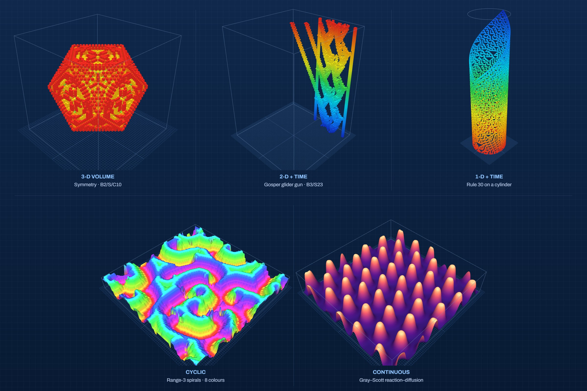

<h1 align="center">Cellular Automata Explorer</h1>

  

  <b>Live:</b> <a href="https://hossbh.github.io/Cellular-Automata-Explorer/"><b>hossbh.github.io/Cellular-Automata-Explorer</b></a> 
  Runs in your browser. Nothing to install or download.

  
   Click the picture or the button to open the live Explorer.

An interactive 3-D explorer for cellular automata, built for learning and experimenting. Every cell follows the same short rule, looking only at its neighbours, yet crystals, clouds, gliders, spirals, fractals and lifelike creatures appear. Pick a case, press play, then change one number and see what happens.

## Five kinds of automaton

| Mode | What you see |
|---|---|
| **3-D volume** | Life-like birth/survival rules on an N × N × N grid, with optional decay states (“Generations” rules) and Moore (26) or von Neumann (6) neighbourhoods. |
| **2-D + time** | Conway's Life and its relatives. Each generation is stacked on the last, so a still life becomes a column, an oscillator a braid and a glider a slanted tube. |
| **1-D + time** | Wolfram's 256 elementary rules as space-time walls, on a flat sheet or wrapped onto a cylinder, plus reversible second-order versions that can run backwards. |
| **Cyclic** | κ colours that chase each other round a loop, with range and threshold (Fisch, Gravner and Griffeath), and the excitable Greenberg–Hastings variant. Random noise turns into rotating spirals. |
| **Continuous** | Real-valued cells: Lenia, with smooth kernels, growth functions and the gliding creature Orbium, and Gray–Scott reaction–diffusion with its spots, stripes and dividing cells. |

Cyclic and continuous fields can be shown as a live 3-D height surface or stacked through time, where a spiral sweeps out a screw surface and a moving creature leaves a tube.

## Concepts covered

- **The seven ingredients** of every cellular automaton (lattice, states, neighbourhood, rule, update scheme, boundary and initial state), each one adjustable.
- **Neighbourhoods:** Moore and von Neumann, larger ranges, and smooth weighted kernels.
- **Discrete, multi-state and continuous states**, and decay (refractory) states.
- **Synchronous vs. stochastic updating:** set the update probability *p* below 1 and watch oscillators and symmetry fall apart.
- **Reversibility:** second-order rules and a ⇄ Reverse button that unwinds history exactly.
- **Langton's λ and the edge of chaos**, computed for the current rule.
- **Wolfram's four classes**, emergence, gliders, self-organisation and pattern formation (Turing patterns), plus notes on concepts not simulated here (other lattices, Wireworld, self-reproducing loops).

## What you can do

- **Case library:** 42 ready-made cases, from the Gosper glider gun and Rule 30 to cyclic spirals, Orbium and dividing Gray–Scott spots, each with a short explanation.
- **Edit the rule:** type a rule string (`B3/S23`, `B4/S4/C5/M`, or the S/B/C/N form `4/4/5/M`), click birth and survival counts, flip the output tiles of a 1-D rule, set colours, range and threshold, or tune μ, σ, F and k. In Gray–Scott mode you can click anywhere on the F–k map.
- **Inspect a cell:** click it in the 3-D view to see its state, its neighbours, its potential or growth, and what the rule will do next.
- **Draw:** paint a seed, plant a spiral core, drop an Orbium, or seed reaction–diffusion spots while the simulation runs.
- **Watch the numbers:** population or mass, births and deaths or activity, and a quick guess at the behaviour (extinct, fixed, periodic, growing and so on).
- **Learn:** plain-language notes on every concept, plus 14 guided experiments that each load with one click.
- **Share:** *Copy link* stores the rule and settings in the URL; *Save image* downloads the 3-D view as a PNG.

Keyboard: <kbd>Space</kbd> play or pause · <kbd>→</kbd> one step · <kbd>R</kbd> restart · <kbd>F</kbd> fit the view.

## Run it locally

The Explorer is a single HTML file with no build step. Download `index.html` and open it in any modern browser with an internet connection (three.js and the fonts load from CDNs).

## How it works

- The simulation runs in plain JavaScript on typed arrays. Neighbour counts are scattered from live cells only, so sparse patterns are cheap; a 48³ volume (110 592 cells) typically steps in 5–15 ms.
- The 3-D view draws every live cell as one instance of a single cube mesh (three.js `InstancedMesh`), skipping cubes hidden inside solid regions. Cyclic and continuous fields are drawn as a height-mapped surface mesh.
- Lenia's convolution scatters each non-zero cell through the kernel, so a lone creature costs a fraction of a full convolution.
- Random starts use a seeded generator, so the same seed always gives the same run.
- Light and dark themes follow the system setting or the toggle in the top bar.

## Further reading

- J. von Neumann, *Theory of Self-Reproducing Automata*, ed. A. W. Burks. University of Illinois Press, 1966.
- M. Gardner, “Mathematical Games: The fantastic combinations of John Conway's new solitaire game ‘life’”, *Scientific American* 223(4), 120–123, 1970.
- S. Wolfram, “Statistical mechanics of cellular automata”, *Reviews of Modern Physics* 55, 601–644, 1983.
- C. Bays, “Candidates for the Game of Life in three dimensions”, *Complex Systems* 1, 373–400, 1987.
- S. Wolfram, *A New Kind of Science*. Wolfram Media, 2002.
- M. Cook, “Universality in elementary cellular automata”, *Complex Systems* 15, 1–40, 2004.
- A. M. Turing, “The chemical basis of morphogenesis”, *Philosophical Transactions of the Royal Society B* 237, 37–72, 1952.
- J. M. Greenberg and S. P. Hastings, “Spatial patterns for discrete models of diffusion in excitable media”, *SIAM Journal on Applied Mathematics* 34(3), 515–523, 1978.
- T. Toffoli and N. Margolus, *Cellular Automata Machines*. MIT Press, 1987.
- C. G. Langton, “Computation at the edge of chaos: phase transitions and emergent computation”, *Physica D* 42, 12–37, 1990.
- R. Fisch, J. Gravner and D. Griffeath, “Threshold-range scaling of excitable cellular automata”, *Statistics and Computing* 1, 23–39, 1991.
- J. E. Pearson, “Complex patterns in a simple system”, *Science* 261, 189–192, 1993.
- S. Rafler, “Generalization of Conway's ‘Game of Life’ to a continuous domain: SmoothLife”, arXiv:1111.1567, 2011.
- B. W.-C. Chan, “Lenia: Biology of Artificial Life”, *Complex Systems* 28(3), 251–286, 2019.

## Credits

3-D rendering by [three.js](https://threejs.org/) (MIT licence). Fonts: Archivo and STIX Two Text from Google Fonts.

The Orbium pattern (*Orbium unicaudatus*) is taken from [Lenia](https://github.com/Chakazul/Lenia), Copyright (c) 2018 Bert Chan, used under the MIT licence.

© 2026 Hossein Basereh. All rights reserved.
